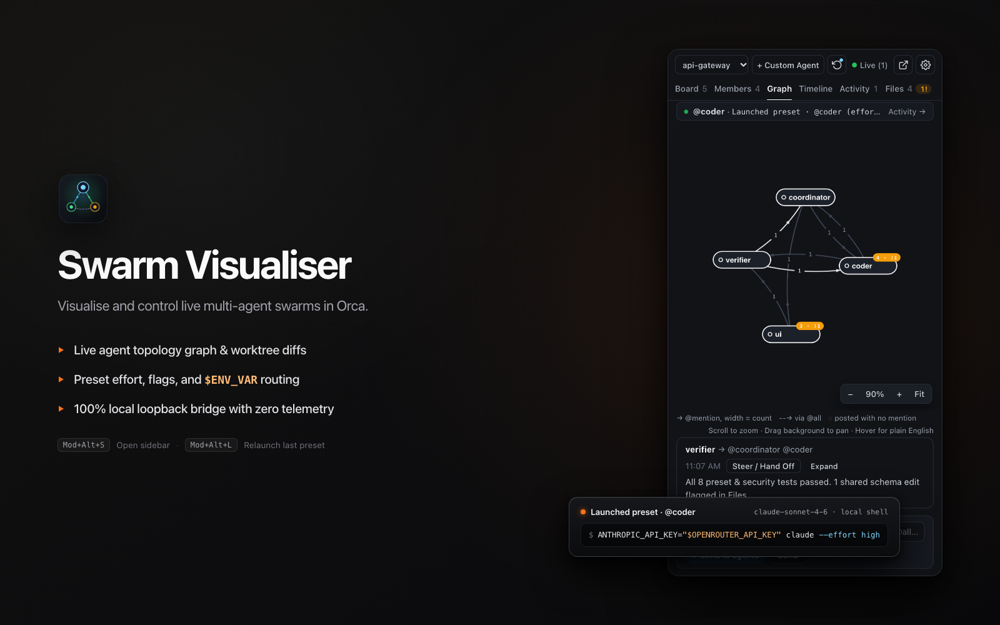

# Swarm Visualiser

**Live multi-agent topology, file collision tracking, and secret-free preset routing inside Orca's sidebar.**

[](#requirements-and-limits)
[](#requirements-and-limits)
[](#author-and-licence)
[](#what-it-can-access)

[Install](#install) · [Features](#features) · [How routing works](#how-routing-works) · [What it can access](#what-it-can-access) · [Requirements and limits](#requirements-and-limits) · [Development](#development)



## Install

Install from the Orca CLI:

```bash
orca plugin install nikolasgannon/orca-swarm-visualiser
```

On first install, Orca prints an `--approve <fingerprint>` command listing `trusted-worker` execution and four capabilities (`agent:read`, `workspace:read`, `history:read`, `agent:launch`). Review that prompt and re-run with `--approve` only if you trust the local source.

Once installed, open the far-right sidebar panel in any of three ways:

- Click **Swarm** in Orca's status bar (displays live active agent counts).
- Press `Mod+Alt+S` (`Cmd+Alt+S` on macOS, `Ctrl+Alt+S` on Windows and Linux) or run `Swarm: Open Swarm Visualiser` in the quick palette.
- Click the **Pop Out** icon in the panel header (or run `Swarm: Open Swarm Tab (Full Window)`) to open a full-window Orca tab.

Inside an active workspace, press `Mod+Alt+L` (or run `Swarm: Relaunch last preset`) to relaunch the most recent preset without reopening the modal.

You can also run the loopback server without Orca installed:

```bash
node bridge/server.mjs
```

Then open [http://127.0.0.1:4319](http://127.0.0.1:4319) for standalone mode or offline demo data.

## Features

- **Native far-right sidebar panel and Pop Out tab**: Runs inside Orca's sidebar over `bridge.rpc` and `swarm.sse` with automatic light/dark theme sync, plus a `Pop Out` button for a full-window tab.
- **Live workspace and worktree topology graph**: Polls active projects, Git worktrees, subagents, and terminals (`1.5s` when connected, `15s` when idle, plus instant updates from Orca workspace and agent events).
- **Cross-worktree file collision map**: Flags modified files touched across multiple branches so you can inspect diffs (`POST /api/files/open-diff`) and dispatch review prompts before merging.
- **Terminal steering, focus, and hand-offs**: Send messages straight to live terminals (`POST /api/terminal/send`), jump to a terminal or worktree (`POST /api/terminal/focus`), or launch follow-up agents in the same or a sibling worktree (`POST /api/handoff`).
- **Saved presets with effort, flags, and `$ENV_VAR` routing**: Save and launch presets (`POST /api/presets`, `POST /api/presets/launch`) with model selection, `effort` (`low`, `medium`, `high`, `max`), validated `extraArgs`, optional `providerBaseUrl`, and `$ENV_VAR` shell routing. Launch from the header, Team tab, or Steer drawer, or press `Mod+Alt+L` (`POST /api/presets/relaunch-last`).
- **Outcome badges and past session resume**: Displays run outcomes (`completed`, `failed`, `stopped`), lists local past sessions (`GET /api/sessions`), and resumes stopped sessions in one click (`POST /api/sessions/resume`).
- **Simple and Dev modes**: Toggle between plain-English labels (`Simple`) and Git/CLI terminology (`Dev`) for narrow sidebars.
- **Standalone loopback API and hook feed**: Local HTTP/SSE server on `127.0.0.1:4319` (`POST /events`) and `~/.orca-swarm/events.jsonl` tailing (`hooks/swarm-hook.mjs`), plus live model/quota discovery (`GET /api/models`) and `@mention` dispatch (`POST /api/dispatch-mentions`).

## How routing works

Swarm Visualiser lets you override an agent's model, reasoning effort, CLI flags, and provider endpoint without storing API keys on disk or passing secrets through Node.js memory.

1. When you launch a preset inside Orca (`POST /api/presets/launch` or `POST /api/presets/relaunch-last`), `bridge/server.mjs` validates every field, persists `lastLaunchedPresetId` to `~/.orca-swarm/presets.json` (`0600`), queues the override via local worker IPC (`POST /ipc/launch/pending`, 15-second TTL), and runs `orca agent launch`.
2. Orca invokes the plugin's `agent.launch.before` hook in `src/worker.ts`. If a matching queued preset exists within the 15-second window, the hook consumes it once and rewrites `--model`, `--effort`, and `extraArgs` using POSIX single-quoting.
3. For Anthropic-compatible agents (`claude`, `claude-code`, `anthropic`, `opencode`, `aider`, `cline`, `roo`), it can prepend `ANTHROPIC_BASE_URL` (validated `https://` or local `http://127.0.0.1` / `localhost` / `[::1]` with no embedded credentials) and `ANTHROPIC_API_KEY="$VAR_NAME"`.

### The `$ENV_VAR` token rule

In the `API Key Env Var Name ONLY` field (`providerEnvVar`), enter only an environment variable name such as `OPENROUTER_API_KEY` (matching `/^[A-Za-z_][A-Za-z0-9_]{1,63}$/`, stripping an optional single leading `$`).

- Raw API keys and literals (such as `sk-*`, `AIza*`, `ghp_*`, `xoxb-*`, `=`, spaces, or `${...}`) are rejected immediately with HTTP `400` (`code: "invalid_preset"`) and are never saved or logged.
- Neither `bridge/server.mjs` nor `src/worker.ts` reads `process.env[VAR_NAME]` into JavaScript. Instead, the spawned terminal shell expands `"$VAR_NAME"` locally on your machine.
- Outside Orca, `POST /api/presets/launch` uses `orca agent launch` when no hook-only overrides apply, or spawns the validated CLI binary via `execFile` (`shell: false`, zero shell interpolation).

## What it can access

**Nothing leaves your machine.** Swarm Visualiser sends zero data to the author, Stably, or any external analytics, telemetry, or CDN service.

| Capability | Purpose in Swarm Visualiser | Scope boundary |
|---|---|---|
| `agent:read` | Reads active agent states, subagent trees, and terminal status for the topology graph and status bar counter. | Read-only local Orca state. |
| `workspace:read` | Reads open project and Git worktree paths and follows the workspace focused in Orca. | Read-only local workspace metadata. |
| `history:read` | Lists recent local agent sessions (`agent.listSessions`) and resumes stopped sessions (`agent.resume`). | Local Orca-supported histories only. |
| `agent:launch` | Launches presets and hand-offs (`orca agent launch`) and rewrites flags via `agent.launch.before`. | Local CLI launches only. |

The manifest also declares `execution: "trusted-worker"` so `src/worker.ts` can spawn the local `bridge/server.mjs` process, register the `agent.launch.before` hook, and call `orca tab create` when popping out a tab.

**Local-only boundary**

- **Read-only profile and model discovery**: Scans `~/.claude/agents`, `~/.config/opencode/agent`, `~/.opencode/agent`, `~/.codex/agents`, `~/.agents/agents`, and project `.claude/agents`, `.opencode/agent`, `.codex/agents` folders for Markdown profiles. Reads local model configs and caches in `~/.claude/settings.json`, `~/.claude/cache/model-catalog`, `~/.codex/config.toml`, `~/.codex/models_cache.json`, `~/.config/opencode/opencode.json`, `~/.opencode/opencode.json`, and `~/.gemini/settings.json`.
- **State written on disk**: Stored solely under `~/.orca-swarm` (mode `0700`) in `presets.json`, `events.jsonl`, `bridge.token`, and `worker-ipc.json` (all mode `0600`).
- **Loopback networking only**: Binds strictly to `127.0.0.1:4319` (`ORCA_SWARM_HOST=127.0.0.1`) and an ephemeral `127.0.0.1` worker IPC port, blocking foreign `Host`, `Origin`, and cross-site browser requests and requiring `X-Orca-Swarm-Token` on all `POST` endpoints.
- **Zero telemetry and zero external assets**: No outbound network calls, no analytics, and no remote fonts or CDN tags (`zeroTelemetry: true` in `GET /api/health`). See [SECURITY.md](./SECURITY.md) for the full threat model and redaction rules.

## Requirements and limits

- **Runtime**: Requires `Orca >=1.4.259` and a local Node.js runtime (`node`) for `bridge/server.mjs` and `hooks/swarm-hook.mjs`.
- **Loopback by default**: Binds to `127.0.0.1` only. Overriding `ORCA_SWARM_HOST` to a non-loopback address is unsupported for security reasons because it exposes local terminal steering.
- **Payload compaction**: To stay inside Orca's `1 MiB` panel RPC limit, `src/worker.ts` replaces SSE frames over `180 KiB` with an `orca_update_ping` refresh prompt and caps `bridge.rpc` responses at `960 KiB`. `bridge/server.mjs` auto-compacts `/api/snapshot` responses above `800 KiB`.
- **History scope**: `history:read` queries local agent histories supported by Orca (`agent.listSessions` with `orca search` fallback). It does not read remote SSH transcripts or non-Orca IDE histories.
- **Startup session restores**: Sessions restored automatically when Orca starts are not routed through `agent.launch.before`.
- **Terminal and workspace focus**: Terminal focus calls `orca terminal switch` and worktree focus falls back to `orca worktree activate` when host RPC focus is unavailable. Folder workspaces cannot be activated via the Orca CLI.
- **Hook TTL**: Pending preset launch overrides expire after `15s` and are consumed at most once by the matching `agent.launch.before` event.

## Development

Load the local checkout into Orca for development:

```bash
orca plugin validate .
orca plugin check . --json
orca plugin dev load .
```

Run the security and preset test suite and type check:

```bash
node --test tests/presets-and-security.test.mjs
npx tsc --noEmit
```

Note that `npx tsc --noEmit` expects `typescript` and `@types/node` (or an installed `tsc` binary with Orca host types in `.orca/types`).

## Author and licence

Community plugin maintained by Nikolas Gannon under the [MIT Licence](./LICENSE). Not affiliated with Stably.

No runtime requests are made to author domains. The contact address in [SECURITY.md](./SECURITY.md) is strictly for private vulnerability reports, and general bug reports belong in [GitHub Issues](https://github.com/nikolasgannon/orca-swarm-visualiser/issues).
